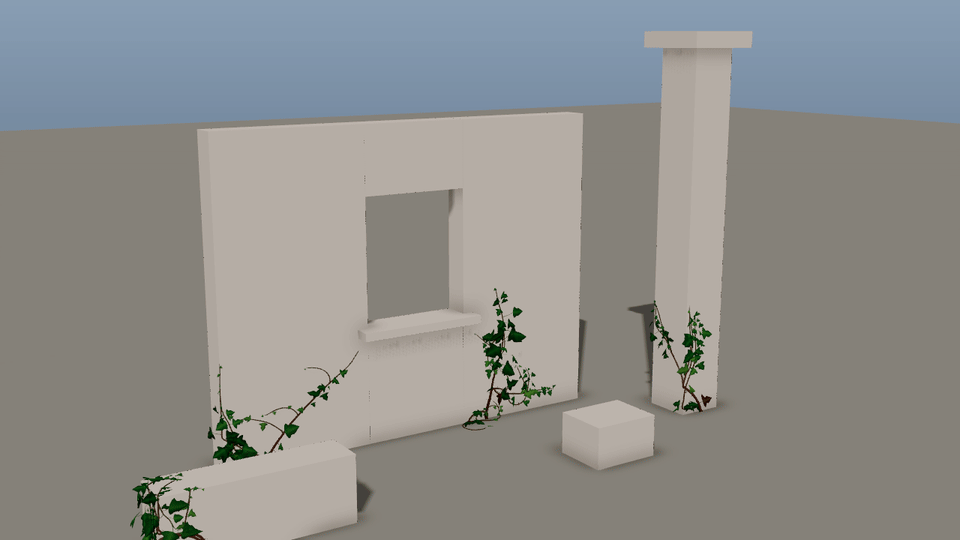
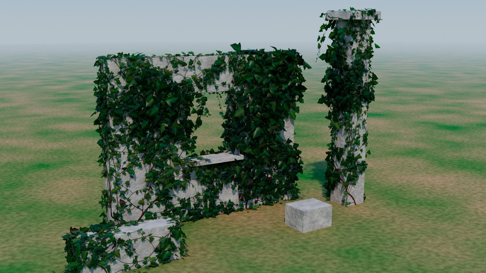
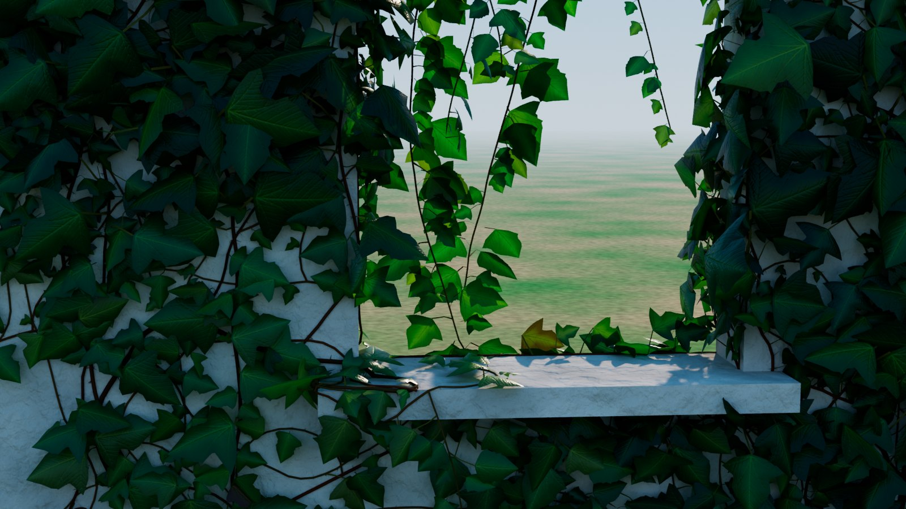
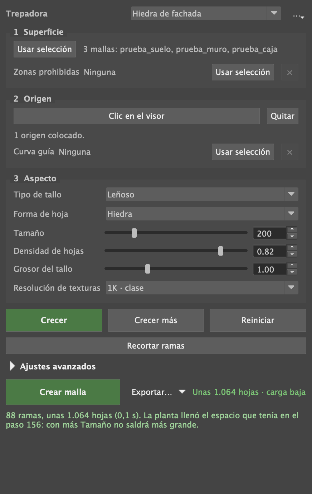
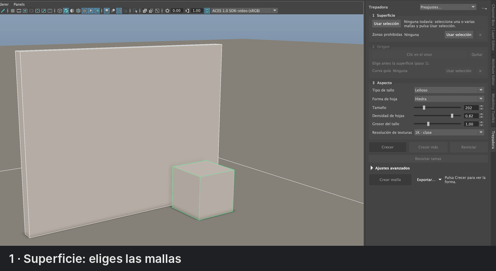
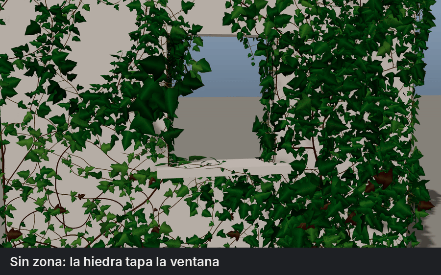
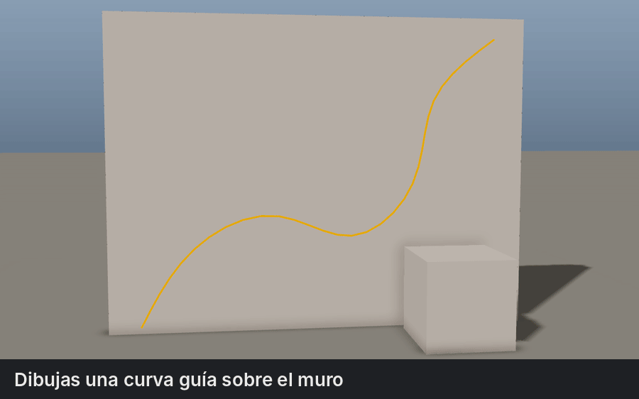
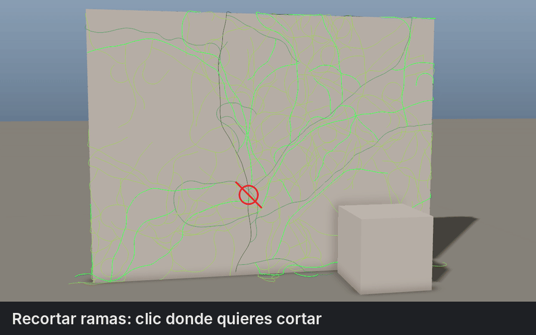
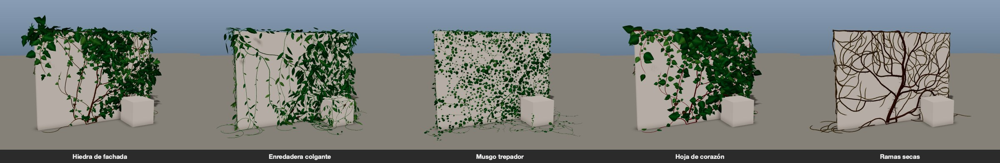

# Trepadora

**Hiedra y plantas trepadoras para Autodesk Maya, en unos clics.** Eliges las mallas por las que
trepa (un muro, una columna, una ruina entera), dices dónde nace y Trepadora hace crecer la planta:
tallos con grosor, raíces adhesivas, rabillos y miles de hojas, lista para renderizar con Arnold o
para exportar a un motor de juego.

Nació como herramienta para un aula de 3D, pero la puede usar cualquiera que trabaje con Maya.



*[English summary below](#english).*

## Qué hace

- **Crece sobre cualquier malla**: sube por las paredes, cuelga de los bordes y repta por el suelo.
  Mismos ajustes y misma semilla dan siempre la misma planta.
- **Ventana guiada en cuatro pasos** (superficie, origen, aspecto, crear malla), acoplable, con una
  vista previa rápida en líneas antes de crear la geometría.
- **Control artístico**: zonas prohibidas (ventanas, puertas), curva guía que la planta sigue y
  recorte de ramas con un clic.
- **Varios tipos de tallo y de hoja** (hiedra, corazón, alargada, redonda) o tu propia hoja
  modelada. Cinco preajustes y los tuyos, que se guardan y se comparten como `.json`.
- **Ligera en la escena**: las hojas son instancias de unas pocas hojas modelo.
- **Lista para Arnold**: materiales con color por hoja, relieve, brillo y luz a contraluz, con
  texturas incluidas en 512, 1K, 2K y 4K.
- **Exporta** a FBX (Unity, Unreal) y Alembic, con sus texturas, y con hojas ligeras para juegos.
- **Todo se deshace** con un solo Ctrl+Z, y la escena recuerda lo que hiciste.
- Interfaz en **español e inglés**, preparada para traducirse a otros idiomas.





## Requisitos

| | |
| --- | --- |
| Maya | 2026 o 2027 |
| Sistema | Windows o macOS |
| Render | Arnold (MtoA) para los materiales completos; sin Arnold funciona igual, con el material del visor |
| Dependencias | Ninguna: usa el Python que trae Maya (no necesita NumPy ni instalar paquetes) |

Probado a fondo en Maya 2027 en macOS. Está pensado para que funcione igual en Windows y en Maya
2026; si encuentras algún problema ahí, [cuéntalo](https://github.com/adrianmantilla/trepadora/issues).

## Instalar

1. Descarga este repositorio (botón **Code → Download ZIP** en GitHub) y descomprímelo
   en una carpeta que no vayas a mover, por ejemplo `Documentos/Trepadora`.
2. Abre Maya y **arrastra el archivo `instalar.py`** de esa carpeta al visor.

Eso es todo. El instalador:

- escribe `trepadora.mod` en la carpeta de módulos de tu usuario de Maya, apuntando a la
  carpeta de Trepadora, para que Maya la encuentre cada vez que arranca;
- carga el plug-in y lo marca para que se cargue solo (aparece el menú **Trepadora**);
- crea el estante **Trepadora** con un botón que abre la ventana;
- abre la ventana.

**Aviso de seguridad de Maya.** Maya avisa cuando carga un plug-in desde una carpeta que no
conoce: *Untrusted Plugin Loading - Security Warning*. Es el plug-in de Trepadora: pulsa
**Allow**. Si marcas antes **Apply to all plugins in this location**, Maya no lo volverá a
preguntar para esa carpeta. Si pulsas **Deny**, la ventana y el estante funcionan, pero no
aparece el menú al abrir Maya y Ctrl+Z no quita de una vez la planta creada con **Crear malla**;
para arreglarlo, arrastra otra vez `instalar.py` y pulsa **Allow**.

**Actualizar:** sustituye la carpeta por la versión nueva y arrastra otra vez `instalar.py` (no
hace falta reiniciar Maya). El instalador no copia nada: si mueves la carpeta, vuelve a
arrastrar `instalar.py`.

**Desinstalar:** en el Script Editor, pestaña Python, ejecuta (con tu ruta):

```python
import sys; sys.path.insert(0, r"C:/ruta/a/Trepadora")   # la carpeta de instalar.py
import instalar; instalar.desinstalar()
```

Quita el módulo, el plug-in y el estante. No borra la carpeta ni tus preajustes.

## Usar la ventana



Abre la ventana con el botón del estante o con **Trepadora → Abrir Trepadora…**. Se puede
acoplar a un lado de Maya y recuerda dónde la dejaste. Los pasos se activan en orden:

1. **Superficie.** Selecciona las mallas por las que trepa la planta (un muro, el suelo,
   una columna; también vale un grupo) y pulsa **Usar selección**. Si entre lo seleccionado
   hay localizadores, se usan como puntos de nacimiento.
   **Zonas prohibidas** (opcional): pon una caja delante de una ventana o una puerta,
   selecciónala y pulsa **Usar selección** en esa fila. La planta la rodea y no crece por
   dentro (ni sus hojas). Valen varias cajas a la vez, giradas o escaladas, y cualquier
   malla (se usa su caja). Después puedes ocultarlas con **H**: la planta las sigue
   esquivando.
2. **Origen** (opcional). Pulsa **Clic en el visor** y haz clic sobre la superficie donde
   nace cada planta; **Quitar** los borra. Sin orígenes, la planta nace en el centro de la
   base de la superficie.
   **Curva guía** (opcional): dibuja una curva sobre la pared o cerca de ella
   (*Create → Curve Tools → EP Curve Tool*), selecciónala y pulsa **Usar selección** en esa
   fila. La planta crece a lo largo de ella, del primer punto que dibujaste al último (para
   darle la vuelta: *Curves → Reverse Direction*). Al llegar al final sigue creciendo a su
   aire. Si no hay orígenes, nace una planta al principio de cada curva. Cuánto la sigue lo
   dice **Seguir la guía**, en los ajustes avanzados de crecimiento.
3. **Aspecto.** Tipo de tallo, forma de hoja, Tamaño, Densidad de hojas, Grosor del tallo y
   Resolución de texturas (ver **Texturas** más abajo).
   Pulsa **Crecer** para ver la forma como líneas (es rápido). Cambia ajustes y vuelve a
   pulsar Crecer hasta que te guste; **Crecer más** la hace más grande sin empezar de cero
   y **Reiniciar** borra las líneas.
   **Recortar ramas:** activa el botón y haz clic sobre una línea de la vista previa, justo
   donde quieres cortar: la rama se corta por ahí, con todo lo que brota más allá. **Ctrl+Z**
   la devuelve. Pulsa **Q** o el mismo botón para terminar. Crear malla usa la planta
   recortada; si vuelves a pulsar Crecer, crece de nuevo sin recortes.
4. **Crear malla.** Crea los tallos con grosor, las hojas y los materiales, y deja la
   planta seleccionada. Todo se deshace con un solo **Ctrl+Z**; **Esc** detiene el
   crecimiento y se conserva lo crecido.

<br clear="right">



### Zonas prohibidas, curva guía y recortar ramas

**Zonas prohibidas.** Una caja delante de la ventana basta para que la hiedra la rodee. Después la
puedes ocultar.



**Curva guía.** La planta nace al principio de la curva y la sigue (aquí con **Seguir la guía** al máximo, en los ajustes avanzados).



**Recortar ramas.** Un clic sobre la vista previa corta la rama y todo lo que brota de ella.



El pie de la ventana dice cuántas hojas saldrán y si la carga es baja, media o alta. Con
carga alta, la ventana pregunta antes de crear la malla.

**Cuando la planta para sola.** La planta deja de crecer cuando llena el espacio que tiene
o cuando sus ramas llegan a su largo máximo, así que a partir de ahí subir el Tamaño no la
hace más grande. La ventana lo dice al crecer. Si pararon por su largo, **Crecer más** las
alarga; si llenó el espacio, añade otra malla en el paso 1 o pon un origen en una zona libre.

**Ajustes avanzados** (plegados): crecimiento (semilla, escala, adherencia, gravedad, luz,
ramificación, **Seguir la guía**…), hojas (tamaño, caída, manchas, bronce, instancias y
**hoja propia**: una malla tuya que se usa como hoja) y tallos (resolución y **Raíces
adhesivas**: raicillas que agarran el tallo a la pared, como las de la hiedra; solo salen
donde el tallo va pegado a una superficie, y con 0 no sale ninguna). Cada ajuste explica qué hace
al dejar el ratón encima.

**Preajustes.** El desplegable de arriba trae cinco: Hiedra de fachada, Enredadera colgante,
Musgo trepador, Hoja de corazón y Ramas secas. Con el botón **…** puedes guardar los tuyos,
importarlos y exportarlos como archivos `.json` (para compartirlos con otras personas o repartirlos en clase), borrar los
tuyos y volver a los valores por defecto. Los tuyos se guardan en la carpeta de preferencias
de Maya, en `trepadora/preajustes`.



**La escena recuerda.** La superficie, las zonas prohibidas, los orígenes, la curva guía, la
hoja propia y los ajustes se guardan
en la escena (grupo `trepadora_origenes_grp`): al abrirla otro día la ventana sigue donde
estaba. Cada planta creada guarda además los ajustes y la semilla con que se hizo: selecciónala
y usa **… → Copiar los ajustes de la planta seleccionada** para repetirla o revisar cómo se hizo.

**Escenas de prueba.** En el menú **Trepadora** hay dos escenas listas para practicar: muro
y caja, y una pequeña ruina.

**Arnold.** Si Arnold (MtoA) está cargado al crear la malla, cada pieza lleva además un
material de Arnold que toma el color de cada hoja y le suma las texturas: nervios, relieve,
brillo y la luz que deja pasar la hoja, que a contraluz brilla y enseña los nervios. Si no
está cargado, la planta solo lleva el material del visor y en el render todas las hojas
salen del mismo verde.

**Texturas.** Las hojas y los tallos llevan texturas que vienen con Trepadora (no hace falta
Substance ni ningún otro programa). En el visor se ven los nervios con la tecla **6**
(texturas); en el render, siempre. Cada textura está en cuatro tamaños y el ajuste
**Resolución de texturas** del paso 3 elige cuál se usa:

| Resolución | Para qué |
|---|---|
| 512 | juegos y escenas con muchas plantas |
| 1K | trabajo diario y clase (por defecto) |
| 2K | renders |
| 4K | renders de cerca |

Cambiarla cambia también las plantas que ya están en la escena, y se recuerda para la
próxima vez. No es un ajuste de cada planta: no se guarda en los preajustes. Si falta un
tamaño en la carpeta, se usa el siguiente más pequeño que haya (o uno más grande si no hay
ninguno) y la ventana lo avisa; por ejemplo, si no vas a usar 4K puedes borrar la carpeta
`texturas/4k` (unos 45 MB). Al renderizar, Arnold puede crear archivos `.tx` junto a las
texturas: son una caché y se pueden borrar.

Las escenas guardan la ruta de las texturas. Si abres una escena hecha en otro ordenador
(en casa con macOS y en clase con Windows, por ejemplo), el plug-in apunta sus texturas a la
carpeta de Trepadora de este ordenador, con la misma resolución, y lo dice en la línea de
mensajes de Maya.

**Exportar.** El botón **Exportar…** del pie de la ventana (o **Trepadora → Exportar planta
seleccionada…**) guarda la planta seleccionada en un archivo para otros programas. Si no hay
nada seleccionado, exporta la última planta creada, o la única que haya en la escena.

- **FBX** (`.fbx`), para motores de juego como Unity o Unreal. Lleva los materiales.
- **Alembic** (`.abc`), para otros programas de 3D. No guarda materiales: las texturas van
  solo en la carpeta.

El archivo tiene dos mallas limpias, con UV y suavizadas: **tallos** (tallos y rabillos) y
**hojas** (todas las hojas en una malla; las instancias no se exportan bien). El color de
cada hoja va en los colores de vértice (`colorSet1`). Al lado se crea la carpeta
`<nombre>_texturas` con las texturas en la **Resolución de texturas** elegida y un mapa de
color por juego (`hoja_hiedra_color.jpg`, `corteza_color.jpg`) que ya lleva el tono medio de
la planta, para los programas que no multiplican la textura por los colores de vértice. Lleva
esa carpeta siempre junto al archivo.

La escena no cambia: la copia que se exporta se borra al terminar. La planta de la ruina, con
unas 8.000 hojas, ocupa unos 33 MB en FBX y 74 MB en Alembic y tarda unos segundos.

**Hojas ligeras para juegos.** La flecha del botón **Exportar…** (o **Trepadora → Exportar
para juegos (hojas ligeras)…**) exporta cada hoja como una tarjeta de seis vértices, doblada
por el nervio, en vez de la hoja completa: pesa unas doce veces menos. La silueta de la hoja
la pone la transparencia del mapa de color, que en este caso es un PNG
(`hoja_hiedra_color.png`). En el motor hay que decirle al material de las hojas que use esa
transparencia:

- **Unity:** activa **Alpha Clipping** en el material de las hojas.
- **Unreal:** pon el **Blend Mode** del material de las hojas en **Masked**.

Las hojas propias no se pueden aligerar (su silueta no está en la textura): se exportan
completas y la ventana lo avisa. Para aligerar aún más, antes de crear la malla baja la
**Densidad de hojas** y pon **Raíces adhesivas** a 0: las raicillas solo se ven de cerca y en
la ruina suman unos 100.000 vértices a los tallos.

**Idioma.** La interfaz está en español y en inglés. Se cambia en **Trepadora → Idioma /
Language**, sin reiniciar Maya: si la ventana está abierta, se vuelve a abrir en el idioma
elegido sin perder lo que tenías, y el idioma se recuerda para la próxima vez.


## Si algo falla

- **No aparece el menú Trepadora al abrir Maya.** Seguramente se pulsó **Deny** en el aviso de
  seguridad: arrastra otra vez `instalar.py` y pulsa **Allow**. Si moviste la carpeta, también
  hay que volver a arrastrarlo.
- **En el render todas las hojas salen del mismo verde.** Arnold no estaba cargado al crear la
  malla. Carga MtoA en el Plug-in Manager y vuelve a pulsar **Crear malla**.
- **No se ven los nervios de las hojas en el visor.** Pulsa **6** (modo con texturas).
- **La escena viene de otro ordenador y faltan texturas.** Basta con tener Trepadora instalada:
  el plug-in vuelve a apuntar las texturas a su carpeta al abrir la escena.
- **Maya va lento.** Mira la carga en el pie de la ventana: baja la **Densidad de hojas** o el
  **Tamaño**, deja las hojas como instancias y usa la resolución de texturas 512 o 1K.

Para cualquier otro problema, abre una [incidencia](https://github.com/adrianmantilla/trepadora/issues)
con tu versión de Maya, tu sistema y lo que sale en el Script Editor.

## Para quien quiera ir más allá

En [docs/REFERENCIA.md](docs/REFERENCIA.md) está el uso desde Python (todos los ajustes del
crecimiento y de las hojas), la estructura del código, cómo rehacer las texturas y cómo traducir
la interfaz a otro idioma. Las pruebas automáticas se ejecutan sin Maya:
`python -m unittest discover tests`.

## Licencia y créditos

Creado por Adrián Mantilla.

El código se publica con la [licencia MIT](LICENSE): puedes usarlo, modificarlo y
redistribuirlo, también en proyectos comerciales, siempre que conserves el aviso de copyright.
La licencia MIT no cubre la textura de la corteza (ver abajo).

**Texturas.** Las de las hojas se dibujan con un script propio
(`herramientas/texturas/generar_texturas.py`). La de la corteza se generó con el material
*Wood Bark* de Adobe Substance 3D Painter (`herramientas/painter/`), así que su uso puede estar
sujeto a las condiciones de Adobe para los materiales de Substance. Si vas a redistribuir esas
texturas fuera de tu propio trabajo, revisa esas condiciones o rehaz la corteza con
`generar_texturas.py --con-corteza`, que crea una corteza procedural sin Substance.

Autodesk, Maya y Arnold son marcas de Autodesk, Inc.; Adobe y Substance son marcas de Adobe. Trepadora es un proyecto independiente, sin relación con esas empresas.

## English

**Trepadora** ("climber") grows ivy and other climbing plants over any mesh in Autodesk Maya
2026 and 2027, on Windows and macOS. It builds thick stems, clinging rootlets, petioles and
thousands of instanced leaves with Arnold materials and textures (512 to 4K), and exports to FBX
(Unity, Unreal) and Alembic, with an optional lightweight leaf-card export for games. It needs
nothing beyond the Python that ships with Maya.

**Install:** download the repository (**Code → Download ZIP**), unzip it somewhere permanent and
drag `instalar.py` into the Maya viewport. If Maya shows *Untrusted Plugin Loading*, click
**Allow**. A **Trepadora** menu and shelf appear.

**Switch the interface to English:** **Trepadora → Idioma / Language → English**. The language
changes without restarting Maya and is remembered.

**Workflow:** in the window, (1) pick the surface meshes and, optionally, forbidden zones (boxes
over windows or doors); (2) click where each plant starts, or pick a guide curve; (3) choose stem
type, leaf shape, size and density, press **Grow** to preview it as lines, and trim branches with
a click; (4) press **Create mesh**. One Ctrl+Z undoes the whole plant. The **Export…** button
writes FBX or Alembic with its textures.

Code under the [MIT license](LICENSE) (the bark texture is not covered: see *Licencia y créditos*).
This README and the reference are in Spanish; the interface is fully translated. Issues in
English are welcome.
